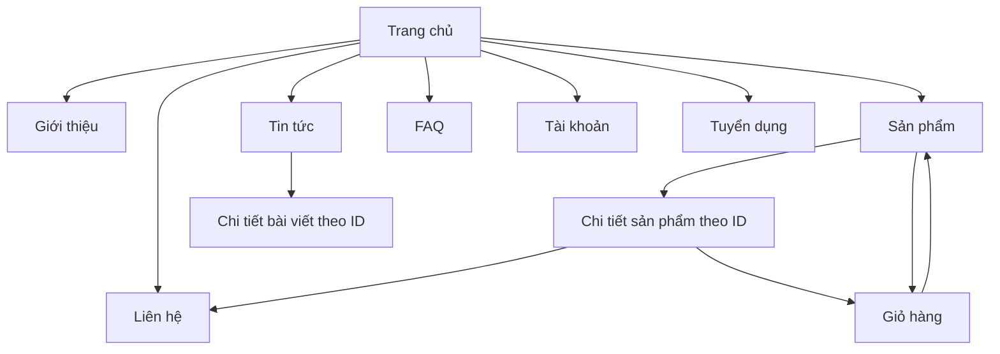

# Báo cáo website sisimimi

Đây là nội dung thuyết trình cho website đi kèm, gồm 14 slide trong `BAO_CAO.pptx`. Nhóm cần tự điền tên thành viên, mã sinh viên, lớp, giảng viên và số nhóm. Nhân vật trên trang giới thiệu là dữ liệu minh họa, không phải tên người thực hiện bài tập.

## Dàn ý 14 slide

### Slide 1 — Trang bìa

**sisimimi — Thế giới nhỏ dành cho bé yêu**. Bài tập nhóm môn Thiết kế Web. Điền thông tin nhóm và ngày trình bày. Mở đầu bằng hình ảnh và màu hồng pastel của thương hiệu.

### Slide 2 — Giới thiệu đề tài

Website bán đồ dùng, thức ăn, quần áo và phụ kiện dành cho chó và cún con. Khách hàng mục tiêu là những người yêu thú cưng. Đây là cửa hàng mô phỏng để học thiết kế giao diện và tương tác ở trình duyệt.

### Slide 3 — Lý do chọn đề tài

Chủ đề chó và cún con gần gũi, dễ xây dựng dữ liệu mẫu và phù hợp phong cách nhẹ nhàng. Bài toán bán hàng giúp thực hành danh sách, chi tiết, tìm kiếm, biểu mẫu và giỏ hàng trong một sản phẩm thống nhất.

### Slide 4 — Mục tiêu và phạm vi

Xây dựng 11 trang HTML khác nhau, dùng chung nhận diện và điều hướng. Cho phép tìm/lọc, xem chi tiết, quản lý giỏ và thử biểu mẫu. Không xây dựng cơ sở dữ liệu, xác thực hoặc thanh toán thật. Tiêu chí: dễ dùng, responsive và mã dễ giải thích.

### Slide 5 — Công nghệ sử dụng

HTML5 tạo cấu trúc ngữ nghĩa. CSS3 dùng Flexbox/Grid, media query, hover và chuyển động nhẹ. JavaScript thuần xử lý sự kiện, dữ liệu mảng/object và localStorage. Live Server hoặc máy chủ tệp Python chỉ phục vụ kiểm tra; Node.js không phải thành phần của website.

### Slide 6 — Cấu trúc thư mục

11 HTML ở thư mục `sisimimi`, một stylesheet `css/style.css`, ba script `js/products.js`, `js/cart.js`, `js/main.js`, thư mục `images` chứa ảnh sản phẩm PNG nền trong suốt và hình thương hiệu cục bộ; thư mục `docs` chứa tài liệu. Đường dẫn tương đối giúp mang dự án sang máy khác mà không cần thay đường dẫn ổ đĩa.

### Slide 7 — Sơ đồ liên kết

Header/footer giúp di chuyển đến các trang chính. Mũi tên mô tả luồng thường dùng, không hàm ý các trang chỉ truy cập được theo một chiều.

### Slide 8 — Giao diện và nhận diện

Hồng pastel kết hợp trắng hồng và kem; chữ nâu đậm. Nút bo tròn, card đồng bộ, ảnh sản phẩm PNG nền trong suốt và minh họa chó/cún lưu cục bộ. Header/footer thống nhất và trang đang mở được đánh dấu. Bố cục dựa trên tệp người dùng cung cấp `S-Chicken(2).zip`: hero, dải lợi ích, danh mục, sản phẩm, khuyến mãi, câu chuyện và tin tức. Màu sắc, nội dung và minh họa chuyển sang chó/cún; không dùng thư viện giao diện. Slide 8 trong PowerPoint có hai ảnh chụp thật từ website bằng Chromium ở viewport 1280 × 900px: [trang chủ](giao-dien-trang-chu.png) và [sản phẩm](giao-dien-san-pham.png).

### Slide 9 — Sản phẩm và tin tức

12 card sản phẩm và 4 bài viết danh sách có sẵn trong HTML, tương tự cách tổ chức bản ZIP tham chiếu. Bộ lọc đặt `hidden` trên `.product-wrapper`. `products.js` cung cấp dữ liệu cho chi tiết, card liên quan và tính giá giỏ; `main.js` cung cấp nội dung chi tiết bài viết. Khi sửa nội dung phải cập nhật các thẻ HTML tương ứng. Tìm kiếm theo tên và lọc 4 nhóm. URL `product-detail.html?id=1` hoặc `news-detail.html?id=1` xác định nội dung. ID sai có trạng thái không tìm thấy.

### Slide 10 — Giỏ hàng và lưu trữ

Giỏ chỉ lưu ID/số lượng ở khóa `sisimimi-cart`. Thành tiền bằng đơn giá nhân số lượng; tổng đơn là tổng các dòng. Có thêm, tăng/giảm, xóa, trạng thái trống và xác nhận mô phỏng. Dùng chung origin để dữ liệu giữ khi chuyển trang. Không lưu mật khẩu hoặc biểu mẫu.

### Slide 11 — Biểu mẫu và tương tác

Kiểm tra bắt buộc, email, điện thoại, khoảng trắng và mật khẩu xác nhận. Có chuyển tab đăng nhập/đăng ký, chọn vị trí ứng tuyển, menu điện thoại, FAQ dùng `details/summary`. Mọi thông báo gửi liên hệ, CV, đăng ký và đặt hàng đều ghi rõ mô phỏng; không truyền hồ sơ đến máy chủ.

### Slide 12 — Responsive và kiểm thử

Lưới sản phẩm thay số cột theo màn hình; chi tiết chuyển thành một cột trên điện thoại. Dùng media query, focus bàn phím và giảm chuyển động. Xem `KIEM_THU.md` để báo đúng những gì đã thực sự chạy. Nhóm cần kiểm tra Chrome và Edge, thêm Firefox khi có điều kiện; không coi Chromium tự động là ba trình duyệt này.

### Slide 13 — Khó khăn, kết quả và giới hạn

Khó khăn: đồng bộ giỏ nhiều trang, dữ liệu lưu hỏng, đường dẫn ảnh, bố cục hẹp và biểu mẫu thiếu trường. Giải pháp: ba script có nhiệm vụ rõ ràng, dữ liệu giá giỏ dùng chung, đồng bộ thẻ HTML, kiểm tra ID/số lượng, đường dẫn tương đối, media query và kiểm tra tính hợp lệ. Những thuộc tính HTML hỏng và nguy cơ gắn sự kiện thêm giỏ nhiều lần của mã tham chiếu được sửa có chủ ý, không sao chép nguyên lỗi. Kết quả mã nguồn gồm 11 trang và các tương tác ở trình duyệt. Bản đồ ngoài cần Internet; nội dung thương hiệu, giá, đánh giá và tuyển dụng là mẫu. Kết quả chạy cụ thể cần lấy từ báo cáo kiểm thử.

### Slide 14 — Hướng phát triển và kết luận

Có thể bổ sung ảnh sản phẩm thật với quyền sử dụng rõ ràng, cải thiện trải nghiệm trợ năng, kiểm tra nhiều thiết bị. Nếu phát triển thành cửa hàng thật cần một dự án riêng về backend, bảo vệ dữ liệu, xác thực và thanh toán. Bản bài tập hiện tại tập trung vào nền tảng HTML/CSS/JavaScript và khả năng giải thích mã.

## Kịch bản demo 5–7 phút

1. **Trang chủ (45 giây):** giới thiệu thương hiệu, chỉ 4 danh mục và một nút mua sắm.
2. **Sản phẩm (60 giây):** lọc quần áo, tìm tên sản phẩm, xóa từ khóa. Mở một sản phẩm, giải thích URL ID.
3. **Giỏ hàng (90 giây):** thêm 2 vòng cổ (ID1, 89.000 ₫) và 1 áo hoodie (ID2, 159.000 ₫) → **337.000 ₫**. Tăng áo thành 2 → **496.000 ₫**. Xóa vòng cổ → **318.000 ₫**. Tải lại để minh họa lưu trữ. Chỉ dùng xác nhận thanh toán mô phỏng.
4. **Tin tức và FAQ (45 giây):** mở bài viết đúng ID; mở/đóng câu hỏi bằng chuột hoặc bàn phím.
5. **Biểu mẫu (60 giây):** nhập dữ liệu sai để thấy lỗi, sau đó dùng dữ liệu giả hợp lệ và đọc thông báo mô phỏng. Không nhập email hoặc mật khẩu thật của thành viên.
6. **Responsive và mã nguồn (60 giây):** thu hẹp cửa sổ, mở menu, rồi chỉ các phần dữ liệu, hàm tính tổng và media query trong VS Code.

Chuẩn bị sẵn giỏ trống trước demo. Giữ nguyên tên miền/cổng trong suốt buổi. Nếu giá mẫu đã được nhóm sửa, tính lại các số tổng trước khi trình bày.

## Câu hỏi bảo vệ gợi ý

**Vì sao có 11 trang?** Có 10 loại trang theo đề và thêm trang chi tiết bài viết, mỗi trang là một tệp HTML riêng có nội dung riêng.

**HTML, CSS, JavaScript khác nhau thế nào?** HTML là cấu trúc/nội dung; CSS là trình bày; JavaScript là hành vi khi tương tác.

**Vì sao không có database vẫn có giỏ hàng?** Giỏ là dữ liệu nhỏ ở localStorage của trình duyệt. Nó không được chia sẻ giữa các máy và không phải đơn hàng của cửa hàng thật.

**Vì sao sửa sản phẩm cần sửa cả HTML?** Danh sách và bốn thẻ nổi bật được viết sẵn để sinh viên dễ đọc và nội dung còn xuất hiện khi tắt JavaScript. `products.js` cung cấp dữ liệu cho chi tiết và giá giỏ; phải giữ hai phần nhất quán.

**Vì sao tách ba tệp JavaScript?** Dữ liệu, tên danh mục, định dạng tiền và tìm ID ở `products.js`; giỏ ở `cart.js`; card liên quan và các tương tác trang ở `main.js`. HTML nạp theo đúng thứ tự để các hàm có dữ liệu cần dùng.

**Vì sao giá không lưu trong giỏ?** Mỗi dòng chỉ cần ID/số lượng; giá đọc từ dữ liệu sản phẩm chung, tránh lệch nhiều nguồn.

**Làm sao biết sản phẩm nào được chọn?** Đọc tham số ID trên URL, tìm trong mảng, hiển thị hoặc thông báo không tìm thấy.

**Làm sao ngăn giỏ hỏng làm trang lỗi?** Bắt lỗi JSON, kiểm tra mảng, ID và số lượng, bỏ dữ liệu không hợp lệ, giới hạn số lượng.

**Vì sao chuyển cổng lại mất giỏ?** localStorage được tách theo giao thức, tên miền và cổng. Dữ liệu vẫn ở origin cũ.

**Đã có đăng nhập thật chưa?** Chưa; chỉ kiểm tra biểu mẫu tại trình duyệt và thông báo mô phỏng. Không lưu mật khẩu.

**Chọn CV đã tải hồ sơ lên chưa?** Chưa; trình duyệt chỉ chọn tệp cục bộ. Không có backend hoặc thao tác gửi tệp.

**Vì sao dùng PNG nền trong suốt cho sản phẩm?** PNG có kênh alpha, giúp sản phẩm tách khỏi nền và hiển thị trên card hồng/kem. Đây là ảnh minh họa được tạo bằng AI theo phong cách chụp sản phẩm, không phải ảnh hàng vật lý đã được kiểm chứng. Banner `hero-dogs.png` cũng có nền trong suốt. Bốn SVG còn lại chỉ gồm logo và ba chân dung đội ngũ. Đường dẫn sản phẩm dùng `product-N.png` và được lưu cục bộ.

**Vì sao không dùng Bootstrap/React?** Đề yêu cầu HTML/CSS/JavaScript thuần, đồng thời giúp người mới hiểu bố cục và sự kiện cơ bản.

**Kiểm tra một trình duyệt có đủ không?** Không; phải báo đúng từng môi trường đã chạy, kiểm tra thêm Chrome/Edge và thiết bị thực khi có thể.

## Trước khi nộp

Điền thông tin thật vào PowerPoint và Excel. Chạy checklist, lưu bằng chứng thực tế, nén `NhomX_sisimimi.zip`, giải nén thử và kiểm tra lại toàn bộ đường dẫn. Không tự điền điểm thành viên hoặc tuyên bố chức năng máy chủ chưa triển khai.
